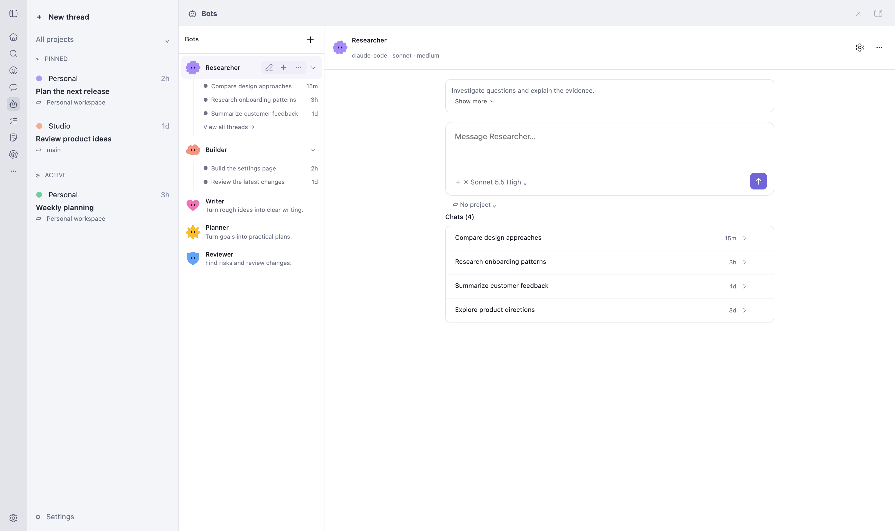
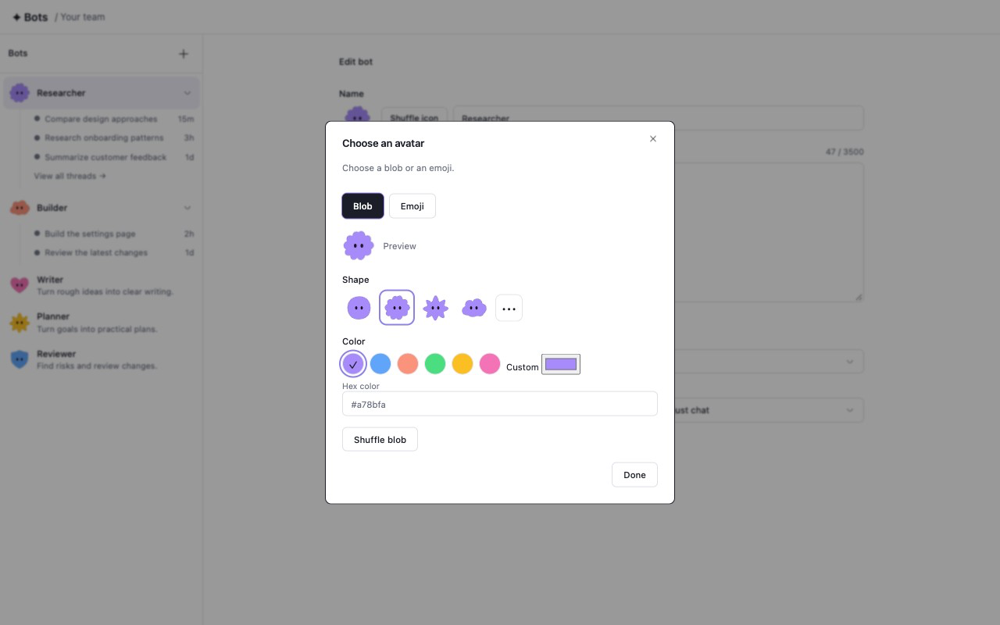

# Bots for BB

Create a small team of AI bots inside BB.

Each bot has its own name, instructions, model provider, model, and reasoning
level. Create a bot once, give it a clear job, and use it whenever you need it
without repeating the same instructions every time.

Your writing bot can stay focused on clear writing. Your research bot can use a
different model. Your coding bot can use the model and reasoning level that
works best for code.

<picture>
  <source media="(prefers-color-scheme: dark)" srcset="assets/screenshots/front-page-dark.png">
  
</picture>

<sub>A team of bots in the BB window. This preview uses sample data and a mock thread sidebar and composer.</sub>

## Why this exists

I like custom GPTs and Grok bots because they let you create a reusable persona
for a specific job. But they are tied to one model provider.

BB gives you more control. You can create your own bots, keep their instructions
in one place, and choose the provider and model for each one.

This plugin brings those two ideas together:

- reusable bots with a clear purpose
- your own instructions for every bot
- a different model provider or model for different kinds of work
- a familiar chat experience inside BB

The goal is simple: build a personal fleet of bots that work the way you work.

## What you can do

With Bots, you can:

- create bots for writing, research, coding, planning, reviews, or any repeatable work
- give every bot its own instructions and personality
- choose a provider, model, and reasoning level per bot
- connect a bot to a project when it needs repository context
- keep bots without a project for everyday conversations
- create drafts before making a bot available to chat with
- keep chat history as normal BB threads
- choose an animated blob avatar or an emoji for each bot
- expand a bot in the rail to open recent threads and see their states

A bot is not a separate chat app. It lives in BB and uses BB's existing thread,
composer, attachment, archive, and delete experience.

## Install

Install from the BB Community marketplace:

```sh
bb plugin install bots
```

Install directly from this repository:

```sh
bb plugin install git:https://github.com/prakashchokalingam/bb-plugin-bots.git
```

Requires BB `>=0.48.1`.

## Create your first bot

1. Open **Bots** from the BB sidebar.
2. Click **New bot**.
3. Give the bot a name and write its instructions.
   Select the avatar to choose a shape, color, or emoji.
4. Choose its provider, model, and reasoning level.
5. Optionally select a project if the bot should work with a repository.
6. Click **Publish**.
7. Start a chat.



<sub>Choose a blob shape and color, or select an emoji. This preview uses sample data.</sub>

<sub>New bots start as drafts. Publish stays disabled until the bot has a name, a provider, and a model.</sub>

For example, you could create:

| Bot | What it does |
| --- | --- |
| Writing partner | Rewrites messages in clear, natural English |
| Code reviewer | Reviews pull requests using your team's standards |
| Research assistant | Investigates a topic and gives a sourced summary |
| Product thinker | Helps turn rough ideas into product decisions |
| Personal assistant | Handles your everyday planning and notes |

## How bots work

Every bot has its own saved instructions. When you start a chat with that bot,
those instructions are applied automatically for that conversation.

You can edit a bot at any time. Changes apply to future chats; an active chat
keeps the instructions it started with.

Bots can be connected to a BB project, but they do not need to be. A project
gives the bot access to repository context. A bot without a project is useful
for writing, thinking, planning, and other general conversations.

The provider, model, project, and reasoning level are used as defaults when you
start a chat. You can still change them before sending the first message.

## Drafts and published bots

New bots start as drafts. This gives you space to set up their instructions,
provider, and model before using them.

A draft cannot start a chat until it has:

- a name
- a provider
- a model

Once published, the bot is ready to use from the Bots sidebar.

## Chats stay in BB

Bot chats are normal BB threads. You can open them, archive them, delete them,
and find them in the sidebar like any other BB conversation.

Deleting a bot does not delete its existing chats. Those chats stay available,
but they no longer receive that bot's instructions.

## Development

```sh
bb plugin install .
bb plugin dev
bb plugin logs bots -f

npm test
npm run typecheck
```

## License

MIT
